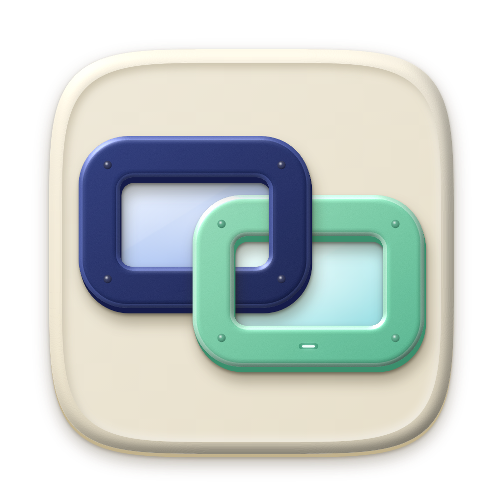
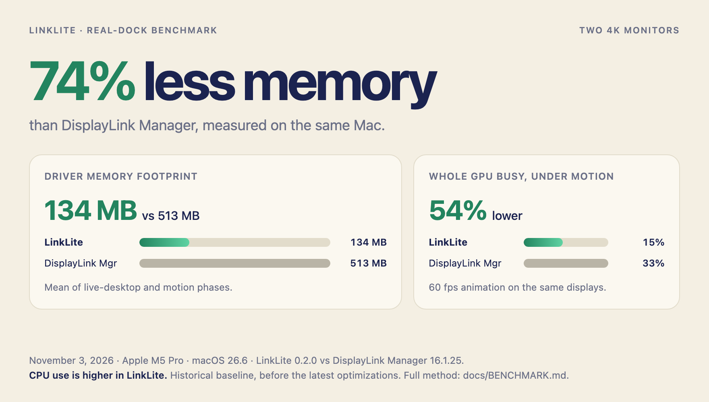
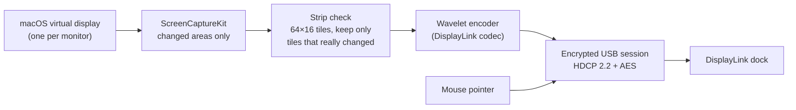

  

<h1 align="center">LinkLite</h1>

  <strong>The lightweight driver for DisplayLink docks on macOS</strong> 
   
  Drive the monitors on your DisplayLink dock without DisplayLink Manager. 
  One small menu-bar app. No background services, no login-window agent, no telemetry. Updates itself.

  
  
  
  
  

  Signed and notarized · Open source · Built on the <a href="https://lwn.net/Articles/1090989/">Vino</a> DisplayLink protocol research

  <picture>
    <source media="(prefers-color-scheme: dark)" srcset="docs/assets/benchmark-dark.png">
    
  </picture>

---

**LinkLite** is a native macOS menu-bar app that talks to DisplayLink USB docks directly. For each monitor on the dock it creates a macOS display, sends only the parts of the screen that change, and lets the dock draw your mouse pointer. Tested daily on a Humanscale M/Connect 2 driving two 4K monitors at 60 Hz.

## Install

1. Download `LinkLite-<version>.dmg` from [Releases](https://github.com/matthewrball/linklite/releases/latest), open it, and drag **LinkLite** into Applications.
2. Quit DisplayLink Manager (menu-bar icon › Quit). Only one app can drive the dock at a time.
3. Open LinkLite and allow **Screen & System Audio Recording** when asked ([why?](#why-does-linklite-need-screen-recording)), then quit and reopen it from its menu-bar icon.
4. Your monitors light up within a few seconds. Turn on **Open at Login** from the menu-bar icon.

Requires macOS 14 Sonoma or later on Apple silicon, and a USB 3 (5 Gbps) link to the dock. From then on LinkLite keeps itself up to date.

## Why LinkLite

- **Light on your Mac.** 3.8x less memory than DisplayLink Manager, a 4 MB app instead of 21 MB, and about half the GPU load under heavy motion. LinkLite's own process never touches the GPU. ([Benchmark](docs/BENCHMARK.md))
- **A clean picture.** Native 4K60 per monitor, sharp HiDPI "looks like" resolutions, and no stale boxes or flicker: changed areas are re-sent to every one of the dock's frame buffers once the screen settles.
- **The dock draws the pointer.** Moving the mouse sends a few bytes of position data instead of re-encoding the screen around it.
- **Nothing extra running.** One process. No kernel extension, no login-window agent, no helper services. Quit it and it is gone.
- **Recovers on its own.** Monitors switched on after LinkLite starts are picked up, and if the dock resets or its cable is replugged, your screens come back by themselves.
- **Stays up to date.** New releases download in the background and install when you say so. Turn it off from the menu-bar icon.
- **Private by construction.** No analytics, no account. The only network traffic is the update check against this repository. See [PRIVACY.md](PRIVACY.md).

## The numbers, including where DisplayLink Manager wins

Two 4K monitors, same Mac (Apple M5 Pro, macOS 26.6), same workload, measured back to back with DisplayLink Manager 16.1.25:

| | LinkLite | DisplayLink Manager |
|---|---|---|
| Whole GPU busy, 60 fps motion | **15%** | 33% |
| GPU time in the driver's own process | **0 ms/s** | 9–168 ms/s |
| Memory | **134 MB** | 513 MB |
| App size | **3.9 MB** | 20.6 MB |
| CPU, live desktop | 55% | **2%** |
| CPU, 60 fps motion | 338% | **20%** |

DisplayLink Manager compresses video on the GPU; LinkLite compresses it on the CPU, so it uses more CPU when large parts of the screen move. A GPU encoder is the next big item on the roadmap. Method, per-run numbers, and raw data: [docs/BENCHMARK.md](docs/BENCHMARK.md).

## Compatibility

| | Status |
|---|---|
| DisplayLink DL-6xxx ("Ridge") docks, e.g. Humanscale M/Connect 2, Dell D6000 | **Tested** (M/Connect 2, two 4K60 monitors) |
| DL-3xxx ("Ella") and DL-7400 ("Navarro") docks | Recognised by the protocol core; untested on macOS |
| Macs | Apple silicon, macOS 14 or later |
| Protected (HDCP) video playback | Not supported |

Tried LinkLite with another dock? Please [file a dock report](https://github.com/matthewrball/linklite/issues/new?template=dock_report.yml), whether it worked or not.

## How it works

The dock speaks DisplayLink's proprietary, encrypted protocol. LinkLite's engine (Rust) builds on the open-source [Vino](https://lwn.net/Articles/1090989/) work, which documented that protocol for Linux, and adds the macOS side (Swift): virtual displays, capture, pointer tracking, and the menu-bar app. Local changes to the vendored protocol core are listed in [`vendor/vino/UPSTREAM.md`](vendor/vino/UPSTREAM.md).

## FAQ

### Why does LinkLite need Screen Recording?

macOS has no public way for an app to provide a display: Apple offers no display driver framework, and display kernel extensions no longer work on Apple silicon. So every USB display product, DisplayLink Manager included, creates a virtual display and reads its pixels back with ScreenCaptureKit, which macOS puts behind the Screen Recording permission. LinkLite captures only the virtual displays it creates for your dock, never your built-in screen, and the pixels go nowhere but the USB dock.

### Is this made by DisplayLink or Synaptics?

No. LinkLite is an independent open-source project and is not affiliated with or endorsed by Synaptics or DisplayLink. DisplayLink is a trademark of Synaptics Incorporated, used here only to describe compatibility.

## Privacy and security

No telemetry, no identifiers; the only network traffic is the update check. Details in [PRIVACY.md](PRIVACY.md). Report vulnerabilities privately as described in [SECURITY.md](SECURITY.md).

## Credits

The DisplayLink protocol, HDCP session, and video codec come from [Vino](https://lwn.net/Articles/1090989/) by Mike Lothian and contributors ([source](https://github.com/cameron1729/Vino)), used under GPL-2.0-or-later.

## License

[GPL-2.0-or-later](LICENSE) © 2026 Matthew Ball.

---

Your monitors, without the weight.

